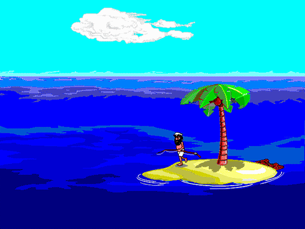

<!-- SPDX-License-Identifier: GPL-3.0-or-later -->
# Castaway Continuum

A **modern, portable, enhanced** fork of the classic **Johnny Castaway** screensaver
(Sierra/Dynamix, 1992) — *"the first screen saver that tells a story."*

## Upstream credit

Castaway Continuum is forked from
[Wilson Reborn by Antigerme](https://github.com/antigerme/wilson-reborn).
That project supplied the upstream foundation; this repository contains the
complete source for the Castaway Continuum V1.0.0 release.

The goal is to bring Johnny back with **full parity** — every gag, event, story beat,
easter egg, holiday and behavior of the original — running on **Windows, Linux and macOS**
at **modern resolutions**, with optional enhancements, without losing anything from the
original.

> 🌎 Em português: **[README.pt-BR.md](README.pt-BR.md)**

## Demo

▶ **Try it live in your browser (bring your own data):** <https://antigerme.github.io/wilson-reborn/>

<p align="center">
  
</p>

*Live renders from the Castaway Continuum engine, driven by the original 1992 data.* The original
screensaver is also preserved at the
[Internet Archive](https://archive.org/details/johnny-castaway-screensaver).

> The artwork is © Sierra/Dynamix, shown here only to illustrate the project. This repository
> ships **no game data** — build and run with your own copy (below) to watch Johnny live.

## Running

Castaway Continuum uses the **original** Johnny Castaway data files (`RESOURCE.MAP` +
`RESOURCE.001`) — there is no bundled art. It looks for the data in this order: `--data
<dir>` → `$CASTAWAY_CONTINUUM_DATA_DIR` → current directory → next to the executable (and in a `data/`
subfolder of each). Without the data it prints where it looked and exits.

```bash
cargo run -p castaway-continuum -- --data <dir>              # your original RESOURCE.MAP/RESOURCE.001
cargo run -p castaway-continuum -- --data <dir> --windowed   # in a 640×480 window (dev)
```

It runs **fullscreen** by default (screensaver behavior); any key/click exits. Requires
stable Rust. `--data` also accepts the Internet Archive `.zip` directly (the run zip or the
installer); see [docs/INSTALL.md](docs/INSTALL.md).

### Windows controls: Classic, Custom, and Scene Sets

The Windows Display menu keeps faithful playback and optional controls separate:

- **Classic** runs the original scheduler and ignores saved Custom scene/environment overrides.
- **Custom** enables your saved lighting, tide, holiday, and island-location preferences.
- **Scene Selector** chooses the scene order. Its **Classic** entry returns scene ordering to
  the original scheduler while retaining the active Custom environment choices. Choosing any
  other Scene Set deliberately overrides the scheduler for browsing or testing.

This distinction means you can, for example, retain a preferred tide or island position while
letting the original animation order play normally. The selector and Island location controller
are floating Windows tools; reopening their Display-menu item restores an existing minimized
window instead of creating duplicates.

### Options

Pass on the command line (override the file, for that run only) or edit the config file
(created on first use; find its path with `wilson /c`):

| Option | Values | Effect |
|---|---|---|
| `--windowed` | — | run in a window instead of fullscreen (`windowed=true`) |
| `--mute` | — | disable sound effects (`mute=true`) |
| `--speed <pct>` | `25`–`400` | animation speed, % of original (`speed=100`) |
| `--scale <mode>` | `fit`\|`stretch`\|`integer`\|`extend` | how the image fills the window; `extend` fills widescreen (`scale=fit`) |
| `--filter <mode>` | `nearest`\|`linear`\|`xbr`\|`xbrz` | upscaling filter (`filter=linear`) |
| `--dedither` | — | smooth the dithered sea/sky (default off = authentic look) (`dedither=false`) |
| `--daynight <mode>` | `original`\|`real24h` | day/night cycle: 8 h as in 1992, or 24 h by the clock (`daynight=original`) |

**Windows screensaver verbs:** `/s` (show), `/p <hwnd>` (preview embedded in the config
dialog's thumbnail - Windows only), `/c` (opens the graphical configuration panel).

## Knowledge base

All the reverse-engineering, the content catalog and the implementation plan are documented
in **[`docs/knowledge-base/`](docs/knowledge-base/README.md)**:

- [01 — History & Credits](docs/knowledge-base/01-historia-e-creditos.md)
- [02 — Content Bible](docs/knowledge-base/02-biblia-de-conteudo.md) *(every feature of the original)*
- [03 — Original Data & Formats](docs/knowledge-base/03-dados-originais-e-formatos.md)
- [04 — Scripting Engine: TTM/ADS Opcodes](docs/knowledge-base/04-engine-scripting-opcodes.md)
- [05 — Engine Architecture](docs/knowledge-base/05-arquitetura-do-engine.md)
- [06 — Reference Projects](docs/knowledge-base/06-projetos-de-referencia.md)
- [07 — Modern Port Plan](docs/knowledge-base/07-plano-do-port-moderno.md)

See also **[docs/ARCHITECTURE.md](docs/ARCHITECTURE.md)** for the data→pixels pipeline and how
to validate. *(The knowledge base is currently in Portuguese; English translation is in
progress.)*

## External references

Castaway Continuum was built from Wilson Reborn and by studying five independent, open-source reimplementations of the
original engine (details in [knowledge base 06](docs/knowledge-base/06-projetos-de-referencia.md)).
They are **not** vendored in this repository — clone the upstreams to compare:

- [jc_reborn](https://github.com/jno6809/jc_reborn) (C/SDL2) — the primary gameplay blueprint
- [ScummVM `dgds`](https://github.com/scummvm/scummvm) (C++) — the DGDS format authority (`engines/dgds`)
- [Johnny-Castaway-Open-Source / JCOS](https://github.com/nivs1978/Johnny-Castaway-Open-Source) (C#) — opcode dictionary
- [castaway](https://github.com/xesf/castaway) & [dgds-viewer](https://github.com/xesf/dgds-viewer) (JavaScript) — metadata & tooling

## Installation / packaging

Prebuilt binaries are published on each version tag by the release workflow. The Windows
download is a `CastawayContinuum-windows-x86_64.zip` folder containing `CastawayContinuum.exe`, `CastawayContinuum.scr`, a
`data` folder placeholder, and short setup instructions. See **[docs/INSTALL-CASTAWAY-CONTINUUM.md](docs/INSTALL-CASTAWAY-CONTINUUM.md)**
to install the Windows screensaver, run on Linux/macOS, and build from source.

> Each release ships a **`SHA256SUMS.txt`** so you can verify your downloads. The Windows
> binaries are **not code-signed**, so SmartScreen will warn ("unknown publisher") — choose
> *More info → Run anyway*. (Code signing may come later, once the project qualifies for a free
> OSS certificate.)

> **Self-contained build (personal use):** if you already own the game, you can embed the
> data in the binary with `CASTAWAY_CONTINUUM_EMBED_DATA=<dir> cargo build --release -p castaway-continuum --features
> embed-data` — a single file that runs without `--data`. The data is copyrighted and is
> **not** redistributed, so that build is never published in releases.

> **GPL source:** a public binary release must be accompanied by access to the exact matching
> source release. Do not distribute a binary from a private checkout unless every recipient is
> also given the corresponding source and build instructions.

> **Run it in a browser (WASM):** 🌐 **live demo: <https://antigerme.github.io/wilson-reborn/>**
> (bring your own data — nothing is uploaded). The engine also compiles to WebAssembly — see
> **[`crates/wilson-web`](crates/wilson-web/README.md)**. Build it with
> `crates/wilson-web/build-web.sh` (or `scripts/build-embedded.sh --web`). Drop your own
> `RESOURCE.MAP`/`RESOURCE.001` (or a `scrantic-run.zip` / `scrantic-installer.zip`) — read
> locally, nothing uploaded — and optionally **save** it in the browser to skip the picker next
> time. Sound is on by default (🔊 + volume), there's a **⛶ fullscreen** button (screen kept
> awake), and URL options mirror the desktop CLI (`?fullscreen&scale=fit&filter=linear&speed=200`
> `&day=5&dissolve&story&daynight=real&intro=0`). No data is bundled (unlike `embed-data`).

## Future opportunities

The current release deliberately keeps the display effects focused on the animation itself.
The experimental physical CRT bezel/cabinet surround was removed because it reduces the useful
viewing area. It remains a possible future option, not part of the shipped display controls.

Other sensible release-quality improvements, in priority order:

- A Windows installer/uninstaller that installs the complete package together, registers the
  screensaver, and provides a Start Menu configuration shortcut.
- Settings backup, export, and import, so Favorites and personal scene descriptions can move
  cleanly between PCs.
- Plain-English data/configuration diagnostics and an optional troubleshooting log.
- Explicit multi-monitor choices and validation at common Windows DPI settings, aspect ratios,
  and small touch displays.
- Authenticode code signing to reduce SmartScreen warnings for public releases.

These are intentionally future work rather than half-finished menu options. The existing EXE,
SCR, beside-program `castaway-continuum.ini`, and `data` folder remain the supported Windows deployment.

## Status

✅ **Complete engine in Rust + live window** (Johnny already runs on screen). Crates:

- `wilson-dgds` — DGDS formats: `RESOURCE.MAP/.001`, RLE/LZW, `.BMP/.SCR/.TTM/.ADS`, disassembler.
- `wilson-engine` — runtime: TTM/ADS interpreters, the director (63 scenes, 11-day cycle,
  holidays/tide/night), pathfinding, walk and island render; the `Show` integration.
- `wilson` — window app (winit + softbuffer) loading the **original files** (`--data` or
  auto-detection); sound, config/options, day persistence and stats.
- `wilson-saver` — the same engine exposed via FFI for a native macOS `.saver`.
- `wilson-web` — the engine compiled to WebAssembly to run in a browser (bring your own data).

Progress and decisions in
[`docs/knowledge-base/08-decisoes-e-status.md`](docs/knowledge-base/08-decisoes-e-status.md).
The focus is **full parity with the original data** (no recreated art).

## Contributing

See **[CONTRIBUTING.md](CONTRIBUTING.md)**. In short: every change must build and pass
`cargo fmt` / `clippy -D warnings` / the workspace tests; every bug fix comes with a
regression test; never commit game data.

## License

**GPL-3.0-or-later** — see [LICENSE](LICENSE). The original game data is **copyright
Sierra/Dynamix** and is never included in this repository.

## Building on Windows

Use the MSVC build instructions in [docs/BUILD-WINDOWS.md](docs/BUILD-WINDOWS.md).
They cover the normal bring-your-own-data build, a personal-use embedded-data build,
and the required Rust toolchain selection.
